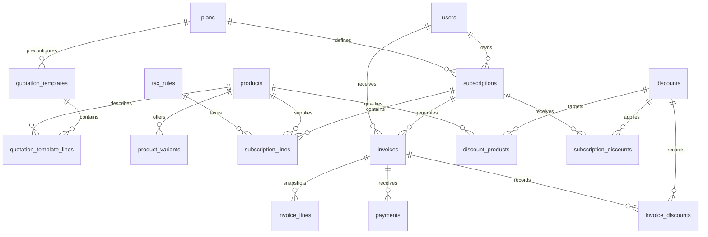

# Data model · Stage 1

Money is stored as integer paise (₹560 = 56000), avoiding floating-point totals. The workspace uses INR. Percentage values use basis points (18% = 1800). Business dates use ISO `YYYY-MM-DD`; database creation timestamps are UTC. Date format validation and business workflow rules will be implemented at the write API layer in subsequent stages.

## Decisions for the next stages

- `users.role` distinguishes admin, staff and customer. Password hashes remain nullable until authentication is implemented; no credentials or default admin account are seeded.
- Products have independent variants with price adjustments. Quotation and subscription lines can reference a variant and a tax rule.
- Plans capture interval, minimum quantity, availability and allowed lifecycle actions.
- Subscription status includes paused alongside the five primary workflow states. The future service layer will enforce transitions and customer-role eligibility.
- Subscriptions have a next billing date, indexed with status for future scheduled billing.
- Invoices retain customer and line snapshots, so catalogue changes do not rewrite billing history.
- Invoice periods use a start-inclusive, end-exclusive convention. A unique `(subscription_id, period_start, period_end)` key prevents inserting the exact same billing period twice. Preventing overlapping periods, handling cancellation/reissue, and concurrency-safe scheduling remain Stage 5 service responsibilities.
- Discounts have date, quantity, purchase and usage constraints. Product targeting, subscription assignment and invoice usage each have separate association tables. Eligibility evaluation and atomic usage accounting belong to Stage 6.
- Payments are separate records so partial payments are possible. Remaining balance, overpayment handling and marking invoices paid belong to Stage 6.
- Database constraints enforce nonnegative money, valid enumerations, foreign keys and invoice header arithmetic. Cross-record checks such as line-total reconciliation belong to transactional write services.
- Stage 3 validates plan availability dates, enumerations and money at the API layer. Products and tax rules that are referenced are archived rather than deleted, and referenced plans cannot be deleted.
- Stage 4 (migration 3) adds `subscriptions.quotation_template_id`, `valid_until` and `notes`, `quotation_templates.payment_terms_days`, and a `subscription_events` history table. Subscription numbers are `SUB-` plus the zero-padded row id, assigned in the same transaction as the insert. Activation sets `next_billing_date` to the start date for Stage 5 billing; closing clears it.
- `schema_migrations` records initial schema version 1; `server/migrations.js` applies later versions in order (version 2 adds catalogue indexes, version 3 adds Stage 4 subscription fields). Initialization is idempotent. Future schema alterations need new ordered migrations; changing `CREATE TABLE IF NOT EXISTS` does not upgrade existing tables.
